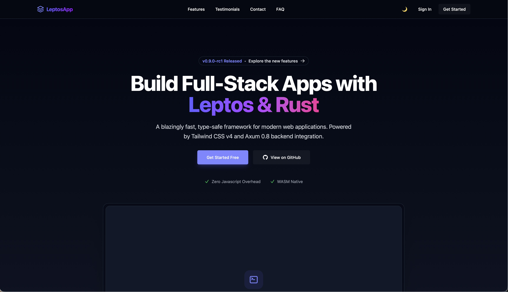

<p align="center">
  <picture>
    <source media="(prefers-color-scheme: dark)" srcset="https://shieldcn.dev/header/graph.svg?title=Pure%20Rust-UI%20Starter&subtitle=Pure%20Rust%20UI%20Starter&logo=rust&mode=dark&theme=slate" />
    
  </picture>
</p>

<p align="center">
  <a href="https://github.com/JumpingJack32/pure-rust-ui-starter/stargazers">
    
  </a>
  <a href="https://github.com/JumpingJack32/pure-rust-ui-starter/actions">
    
  </a>
  <a href="https://github.com/JumpingJack32/pure-rust-ui-starter/blob/main/LICENSE">
    
  </a>
  <a href="https://github.com/JumpingJack32/pure-rust-ui-starter/issues">
    
  </a>
  <a href="https://github.com/JumpingJack32/pure-rust-ui-starter/commits/main">
    
  </a>
</p>

# Pure Rust-UI Starter

A clean starting point for building a desktop or native user interface entirely in Rust.

This project is designed to give you a simple, modern foundation for creating a UI-driven Rust application without needing a separate JavaScript or frontend stack.

<p align="center">
  <picture>
    <source media="(prefers-color-scheme: dark)" srcset="/public/landing.jpeg" />
    
  </picture>
</p>

## Why this starter?

- Pure Rust application development
- Easy to extend for desktop UI workflows
- Minimal setup for experimentation and product prototypes
- Good foundation for a custom native UI app

## Features

- Rust workspace-ready structure
- Simple app entry point
- Build and run pipeline via Cargo
- Easy to customize for your own interface and logic
- Suitable as a starting point for a more advanced Rust UI project

## Prerequisites

Before running the project, make sure you have the following installed:

- Rust and Cargo (stable toolchain)
- A supported operating system for your target platform
- Any platform-specific native development tools required by your chosen UI crate

To confirm Rust is installed:

```bash
rustc --version (rustc 1.99.1 (58cf8f9c3 2026-10-13))
cargo --version (cargo 1.99.1 (5f94df478 2026-08-27))
```

## Quick start

Clone the repository:

```bash
git clone https://github.com/JumpingJack32/pure-rust-ui-starter.git
cd pure-rust-ui-starter
```

## Run the project

```bash
cargo leptos watch  # For Web
```

Build the project:

```bash
cargo build
```

Run the app:

```bash
cargo run
```

## Project structure

```text
.rust-ui-starter/
├── app
│   ├── Cargo.toml
│   └── src
│       ├── app.rs
│       ├── components
│       └── lib.rs
├── Cargo.lock
├── Cargo.toml
├── public
│   └── landing.jpeg
├── README.md
├── server
│   ├── Cargo.toml
│   └── src
│       └── main.rs
├── style
│   ├── tailwind.css
│   └── tailwindcss-animate.css
└── ui_components
    ├── Cargo.toml
    └── src
        ├── components
        └── lib.rs

```

If your project uses a different layout, adjust the structure above to match your actual files.

## Development workflow

During development, you can:

```bash
cargo fmt
cargo check
cargo run
```

This keeps the project clean while quickly validating the application as you build it.

## Extending the starter

This template is meant to be modified. Common next steps include:

- defining your app layout
- adding components and widgets
- wiring up state and user interactions
- integrating services, storage, or configuration
- improving styling and theming

## Contributing

Contributions, ideas, and improvements are welcome.

If you want to improve the starter:

1. Fork the project
2. Create a feature branch
3. Make your changes
4. Run validation commands
5. Open a pull request

## Notes

This repository is a starter template and can be customized for your own product or experiment.

It is intentionally lightweight so that you can build on top of it without unnecessary boilerplate.

## How to use `cargo` to create the UI Library

```bash
cargo new ui_components --lib
```

Cargo will add it automatically to the main Cargo.toml in the root directory :

```toml
[workspace]
resolver = "2"
members = ["app", "server", "ui_components"]
...
```

Then you can move or create your component files:

1. Match the exact version your root toml (e.g., "0.78 or "0.9.0-rc" )
2. Create a button.rs file inside ui_components/src/.
3. Open ui_components/Cargo.toml and add Leptos to its dependencies so it understands your components:

---
